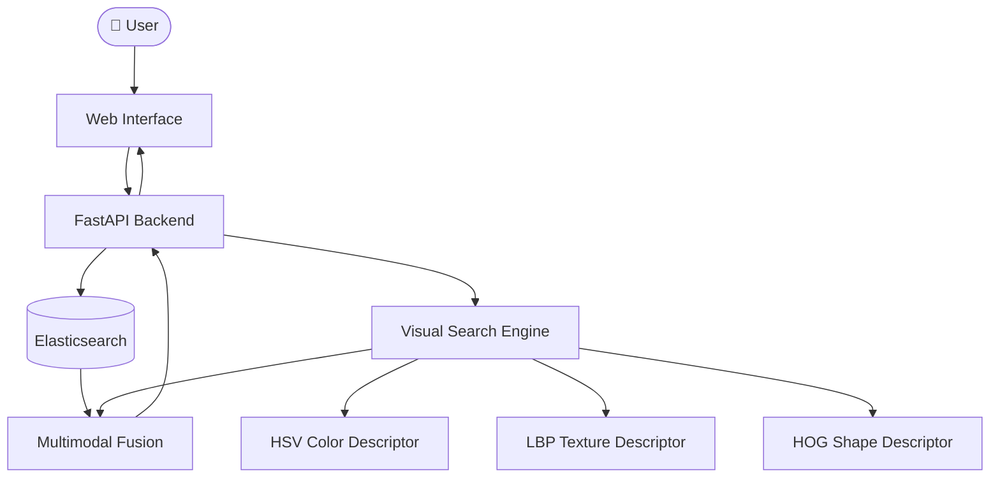

# 🔍 Multimodal Content-Based Image Retrieval (CBIR) Engine

<p align="center">
  
  
  
  
  
  
</p>

This project is a **multimodal image and text search engine** developed as part of the *Massive Multimedia Indexing and Retrieval* course at **SUP'COM**. It combines **visual descriptors** (HSV, LBP, HOG) with **Elasticsearch** for text search, a **FastAPI** backend, and a **web interface** for interactive image retrieval.

---

## 📜 Table of Contents

- [📂 Project Architecture](#-project-architecture)
- [🚀 How It Works](#-how-it-works)
  - [Visual Feature Extraction](#1-visual-feature-extraction)
  - [Elasticsearch Integration](#2-elasticsearch-integration)
  - [FastAPI Backend](#3-fastapi-backend)
  - [Web Interface](#4-web-interface)
  - [Multimodal Fusion](#5-multimodal-fusion)
- [📸 Features](#-features)
- [🛠️ Technology Stack](#%EF%B8%8F-technology-stack)
- [🔧 How to Run the Project](#-how-to-run-the-project)
  - [Prerequisites](#prerequisites)
  - [Clone the Repository](#1-clone-the-repository)
  - [Build and Run with Docker Compose](#2-build-and-run-with-docker-compose)
  - [Manual Local Execution](#3-manual-local-execution)
  - [Access the Application](#4-access-the-application)
- [📂 Folder Structure](#-folder-structure)
- [🛡️ Environment Variables](#%EF%B8%8F-environment-variables)
- [📊 Results](#-results)
  - [Search by Text](#search-by-text)
  - [Search by Image](#search-by-image)
  - [Search by Text + Image](#search-by-text--image)
- [🤝 Contributors](#-contributors)

---

## 📂 Project Architecture



---

## 🚀 How It Works

### 1. **Visual Feature Extraction**
- Extracts visual features from images using **3 descriptors**:
  - **HSV**: Captures the color distribution of the image.
  - **LBP**: Captures the texture patterns of the image.
  - **HOG**: Captures the shape and edge information of the image.
- These features are used to compare images and find visually similar ones.

### 2. **Elasticsearch Integration**
- Indexes all images with their **category names**, **tags**, and **titles** into Elasticsearch.
- Supports **fuzzy matching**, **accent folding**, and **stemming** for accurate text search.

### 3. **FastAPI Backend**
- Provides a **REST API** for handling search requests.
- Users can search by **text**, **image**, or **both** and receive ranked results.

### 4. **Web Interface**
- Built with **HTML, CSS, and JavaScript** (no heavy frameworks).
- Supports **drag-and-drop image upload** and **keyword search**.
- Click on any result image to search for similar images instantly.

### 5. **Multimodal Fusion**
- Combines text and visual search results using **Reciprocal Rank Fusion (RRF)**.
- Supports **AND** mode (text filters → visual reranking) and **OR** mode (merged results from both).

---

## 📸 Features

- 🎯 **3 Visual Descriptors**: Color (HSV), Texture (LBP), Shape (HOG)
- ⚡ **VP-Tree Acceleration**: Faster search using metric tree indexing
- 🔤 **Text Search**: Elasticsearch with fuzzy matching and stemming
- 🔀 **Multimodal Search**: Combine text + image queries (AND / OR)
- 🖼️ **Image Upload**: Upload any image from your computer
- 🔄 **Click to Re-search**: Click any result to search with that image
- 🐳 **Docker Ready**: One-command deployment with Docker Compose

---

## 🛠️ Technology Stack

| Component | Technology | Description |
| :--- | :--- | :--- |
| **Feature Extraction** | OpenCV, scikit-image, NumPy | HSV, LBP, and HOG descriptors |
| **Visual Index** | VP-Tree, Linear Search | Fast nearest-neighbor retrieval |
| **Text Search** | Elasticsearch 7.17 | Full-text search with fuzzy matching |
| **Backend** | FastAPI, Uvicorn | REST API server |
| **Frontend** | HTML5, CSS3, JavaScript | Interactive web interface |
| **Containerization** | Docker, Docker Compose | Easy deployment |

---

## 🔧 How to Run the Project

### Prerequisites
- [Docker Desktop](https://www.docker.com/products/docker-desktop/) installed and running
- Python 3.10+ (only for manual execution without Docker)

### 1. Clone the Repository
```bash
git clone https://github.com/nesrine414/projet-cbir.git
cd projet-cbir
```

### 2. Build and Run with Docker Compose
```bash
docker compose up --build
```

### 3. Manual Local Execution

If you prefer to run without Docker:

```bash
# Create virtual environment
python -m venv .venv
.venv\Scripts\activate        # Windows
# source .venv/bin/activate   # Linux/Mac

# Install dependencies
pip install -r requirements.txt

# Start Elasticsearch (via Docker)
docker run -d --name es-cbir -p 9200:9200 -e "discovery.type=single-node" -e "xpack.security.enabled=false" elasticsearch:7.17.13

# Build the visual index (run once)
python scripts/build_index.py
# Build a balanced 10,000-image MIRFLICKR sample index (run once)
python scripts/build_index.py --dataset mirflickr --limit 10000

# Index data into Elasticsearch (run once)
python scripts/ingest_es.py

# Start the API server
uvicorn api.main:app --host 0.0.0.0 --port 8000 --reload
```

### 4. Access the Application

| Service | URL |
| :--- | :--- |
| **Web Interface** | [http://localhost:8000/web/](http://localhost:8000/web/) |
| **API Docs (Swagger)** | [http://localhost:8000/docs](http://localhost:8000/docs) |
| **Elasticsearch** | [http://localhost:9200](http://localhost:9200) |

Check [http://localhost:8000/health](http://localhost:8000/health) to confirm the API can reach Elasticsearch. The `text_index` field is `false` until the text documents are loaded; create the index with `python scripts/ingest_es.py`.

The `objects` dataset and its `index/index.pkl` remain unchanged. MIRFLICKR is served from `data/mirflickr/` and uses its own `index/mirflickr.pkl`; build a balanced sample with `python scripts/build_index.py --dataset mirflickr --limit 10000` before selecting it for visual search. The current MIRFLICKR folder contains 797,039 images, so indexing all of them with all descriptors is a multi-day operation; `--limit` samples evenly across its storage shards. MIRFLICKR results do not show category labels or use category reranking, and keyword search is available for Objects only because MIRFLICKR has no text annotations.

---

## 📂 Folder Structure

```
projet-cbir/
├── api/                     # FastAPI backend
│   ├── main.py              # API routes
│   └── schemas.py           # Request/response models
│
├── config/                  # Configuration files
│   ├── category_tags.json   # Category tags and translations
│   └── settings.py          # Environment settings
│
├── data/objects/             # Image dataset (Caltech-101)
├── data/mirflickr/           # MIRFLICKR image dataset
│
├── index/                   # Precomputed visual index
│   ├── index.pkl            # Objects feature signatures
│   └── mirflickr.pkl        # MIRFLICKR feature signatures
│
├── scripts/                 # Offline pipelines
│   ├── build_index.py       # Visual feature extraction
│   ├── ingest_es.py         # Elasticsearch indexing
│   └── benchmark.py         # Performance benchmarks
│
├── src/cbir/                # Core CBIR library
│   ├── descriptors/         # HSV, LBP, HOG extractors
│   ├── index/               # Linear search & VP-Tree
│   ├── distances.py         # Distance functions
│   ├── fusion.py            # Multimodal fusion (RRF)
│   └── text_search.py       # Elasticsearch client
│
├── tests/                   # Unit tests
├── web/                     # Frontend (HTML/CSS/JS)
│
├── docker-compose.yml       # Docker Compose config
├── Dockerfile               # Docker image recipe
└── requirements.txt         # Python dependencies
```

---

## 🛡️ Environment Variables

Create a `.env` file from the example:

```bash
cp .env.example .env
```

```env
ES_URL=http://localhost:9200
ES_INDEX=cbir_images
DATA_DIR=data/objects
INDEX_DIR=index
```

---

## 📊 Results

### Search by Text
Enter keywords like **"watch"**, **"butterfly"**, or **"water lily"** to find matching images.

### Search by Image
Upload any image to find visually similar images from the database.

### Search by Text + Image
Choose **Text + Image** in the search type menu, enter a keyword, and upload an image or select one from the results. Choose the combination rule:
- **AND mode**: Text narrows the results, then visual similarity reranks them.
- **OR mode**: Merges both text and visual results using rank fusion.

### Benchmark: Linear Search vs VP-Tree

| Method | Avg Query Time | Speedup |
| :--- | :---: | :---: |
| **Linear Search** | ~18.5 ms | 1.0x |
| **VP-Tree** | ~4.2 ms | **4.4x faster** |

---

## 🤝 Contributors

Project developed at **SUP'COM** (École Supérieure des Communications de Tunis):

- **Inès Besbes** — Visual Search Engine & Indexing
- **Nesrine Hamrouni** — API, Text Search & Multimodal Fusion
