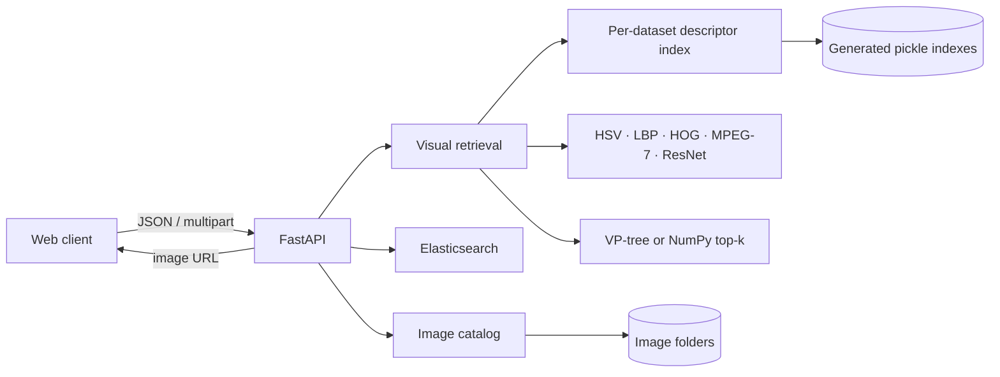

# Architecture

## Data flow

1. `scripts/build_index.py` extracts one or more descriptor vectors per image and writes the selected dataset index under `index/`.
2. The API loads the requested dataset index once, aligns each descriptor into a NumPy matrix, and exposes only descriptors present in that index.
3. A stored query image is resolved within its dataset folder. An uploaded query is decoded in memory. Both follow the same feature extraction and ranking path.
4. One-descriptor queries on indexes up to 12,000 images use a cached VP-tree. Multi-descriptor and larger queries compute exact distances against aligned matrices and select the best k results without sorting the full list.
5. Text-only searches query Elasticsearch. For AND searches, text results restrict the candidates before visual ranking. For OR searches, visual and text rankings are combined with reciprocal rank fusion.
6. The API returns image IDs and relative URLs. The browser uses those URLs to display images and can submit a result as the next query.

## Collections and generated files

- `data/objects/` is the Objects collection and is indexed to `index/index.pkl`.
- `data/mirflickr25k/` contains the MIRFLICKR-25K images, Flickr tags, and topic annotations. The selected image root is `data/mirflickr25k/mirflickr/`; its MPEG-7 signatures are stored in `index/mirflickr.pkl`.
- The older `data/mirflickr/` thumbnail folder is not used by the API or index builder.
- `index/` and `data/` are excluded from Git; the index can be rebuilt from the local image folders.
- Elasticsearch stores dataset, image ID, relative image URL, category, title, and tags. MIRFLICKR documents combine Flickr tags with manual topic annotations; Objects uses its category tag file.
